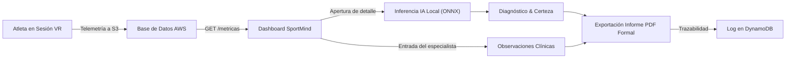

# 🧠 SportMind VR 

<div align="center">


**Plataforma de Evaluación y Analítica Cognitivo-Deportiva con Realidad Virtual e Inteligencia Artificial**

[](https://astro.build/)
[](https://www.electronjs.org/)
[](https://tailwindcss.com/)
[](https://onnxruntime.ai/)
[](https://aws.amazon.com/)
[](https://nodejs.org/)

</div>

---

## 📌 Descripción del Proyecto

**SportMind** es una solución tecnológica e interdisciplinaria orientada a la psicología y rendimiento deportivo de alto nivel. A través de sesiones inmersivas en **Realidad Virtual (RV)**, el sistema recolecta telemetría objetiva de los atletas en pruebas de tiro al blanco y escalada/muro, combinada con escalas de autorreporte emocional y autoevaluación subjetiva.

La plataforma permite a entrenadores, psicólogos deportivos y especialistas clínicos:
1. Gestionar, monitorear y analizar sesiones de evaluación cognitivo-deportiva.
2. Ejecutar inferencias en tiempo real mediante **modelos de Inteligencia Artificial (ONNX)** ejecutados localmente para clasificar la regulación de conducta y autorregulación del atleta.
3. Registrar observaciones clínicas cualitativas.
4. Generar y exportar **informes técnicos institucionales en formato PDF** de 2 páginas con datos 100% dinámicos, gráficos y recomendaciones.
5. Ejecutar la solución como **aplicación nativa de escritorio (Electron para Windows)** o desplegarla como **servicio web en contenedor Docker**.

---

## 👥 Integrantes del Equipo

* **Patricio González**
* **Matías Díaz**
* **Francisco Bilbao**

---

## 🚀 Funcionalidades Principales

### 📊 1. Panel de Control y Analítica de Sesiones
* **Vistas flexibles:** Alterna entre vista de **tarjetas (Cards)**, **tabla de datos (Table)** y **gráficos comparativos (Charts)** mediante Chart.js.
* **Filtros en tiempo real:** Filtrado por disciplina deportiva, estado emocional post-tarea y búsqueda inteligente por nombre de atleta o ID de sesión.
* **Métricas clave (KPIs):** Resumen global de sesiones totales, distribución emocional y promedio de rendimiento en tiro y escalada.

### 🤖 2. Inferencia de Inteligencia Artificial en el Cliente
* **Inferencia local en el navegador (ONNX Runtime Web):** Los datos biométricos y de telemetría no se exponen a APIs externas de terceros para preservar la privacidad del deportista.
* **Modelo de Regulación de Conducta (`modelo_regulacion_conducta.onnx`):** Clasifica patrones de conducta en base a variaciones de puntajes de tiro y tiempos de escalada entre niveles fácil y difícil.
* **Modelo de Autorregulación (`modelo_autoregulacion.onnx`):** Modelo de respaldo ante contingencias de datos.
* **Ejecución automática con caché:** La inferencia se activa automáticamente al abrir el modal de informe detallado, almacenando el resultado en caché en memoria para una respuesta instantánea en reaperturas.

### 📝 3. Observaciones Clínicas del Especialista
* **Anotaciones personalizadas:** Cuadro de texto interactivo en el detalle de la sesión para que el evaluador redacte apreciaciones cualitativas sobre el desempeño del atleta.
* **Sincronización con el informe:** El contenido se traslada de manera directa y formateada al PDF final.

### 📄 4. Motor de Generación de Informes en PDF
* **Documento formal A4 de 2 páginas:** Cumple con estándares de informe de evaluación cognitivo-deportiva (`generadorpdf.ts`).
* **Datos 100% dinámicos:** Mapeo completo de código de sesión, datos demográficos, emociones previas/posteriores, métricas cuantitativas, desglose de autoevaluación y veredicto de la IA.
* **Síntesis interpretativa automática:** Redacción contextual generada en base a la caída/aumento de puntaje y el diagnóstico del modelo.
* **Garantía de exportación:** Si el usuario descarga el PDF inmediatamente, el sistema resuelve la predicción de IA en segundo plano asegurando que el documento nunca salga incompleto.

### 🔐 5. Seguridad, Autenticación y Auditoría (AWS)
* **Gestión de Identidades con Amazon Cognito:** Inicio de sesión seguro con tokens JWT, flujo de cambio de contraseña forzada en primer acceso y validación de roles.
* **Registro de Auditoría (Logs):** Trazabilidad de todas las acciones del especialista (logins, descargas de PDF, consultas de datos en bruto, ejecuciones de IA) persistidas en Amazon DynamoDB vía API Gateway.
* **Actualizaciones Automáticas (Desktop):** Integración con `electron-updater` para detección y descarga automática de nuevos instaladores publicados en GitHub Releases.

---

## 🛠️ Tecnologías y Paquetes

### Frontend y Servidor Web
* **[Astro 7](https://astro.build/):** Arquitectura de componentes rápidos e integración con `@astrojs/node` para SSR (Server-Side Rendering) y endpoints API REST.
* **[Tailwind CSS v4](https://tailwindcss.com/):** Estilos utilitarios optimizados con `@tailwindcss/vite`.
* **[Chart.js](https://www.chartjs.org/):** Renderizado de gráficos interactivos de barras y líneas para rendimiento y confianza.

### Inteligencia Artificial
* **[ONNX Runtime Web](https://onnxruntime.ai/docs/tutorials/web/):** Ejecución de tensores e inferencia directa en el navegador mediante WebAssembly.

### Generación de Documentos
* **[html2canvas-pro](https://www.npmjs.com/package/html2canvas-pro):** Renderizado pixel-perfect del árbol DOM a canvas HTML5.
* **[jsPDF](https://github.com/parallax/jsPDF):** Ensamblado y exportación de páginas PDF en tamaño A4 con soporte para multipágina.

### Entorno Desktop y Empaquetado
* **[Electron 44](https://www.electronjs.org/):** Wrapper nativo para escritorio.
* **[electron-builder](https://www.electron.build/):** Generador de instaladores NSIS para Windows (`.exe`).
* **[electron-updater](https://www.electron.build/auto-update):** Actualizaciones continuas desde GitHub Releases.
* **[concurrently](https://www.npmjs.com/package/concurrently) & [wait-on](https://www.npmjs.com/package/wait-on):** Orquestación de procesos de desarrollo simultáneos.

### Infraestructura Cloud (AWS)
* **Amazon Cognito:** User Pools para autenticación y autorización.
* **Amazon S3:** Repositorio de métricas de telemetría VR en formato JSON.
* **Amazon DynamoDB:** Almacén de logs de auditoría y especialistas registrados.
* **AWS Lambda & API Gateway:** APIs intermediarias protegidas por autorización JWT.

---

## 📂 Estructura del Proyecto

```text
fE-Sportmind/
├── .github/workflows/       # Pipelines de CI/CD (Releases automáticos con GitHub Actions)
├── electron/                # Código del proceso principal y preload de Electron
│   ├── main.cjs             # Ventana principal, auto-updater y ciclo de vida de la app
│   ├── preload.cjs          # Puente seguro entre Electron y el renderizador
│   └── prepare-server.cjs   # Configuración de arranque para servidor empaquetado
├── public/                  # Archivos estáticos, logos, iconos y modelos ONNX
│   ├── modelo_regulacion_conducta.onnx   # Modelo IA de conducta en RV
│   ├── modelo_autoregulacion.onnx        # Modelo IA de autorregulación previa
│   └── favicon / icon.ico                # Identidad visual e iconos de instalador
├── src/
│   ├── assets/              # Recursos gráficos y SVGs
│   ├── components/          # Componentes reutilizables de UI
│   ├── layouts/             # Plantilla base (Layout.astro, encabezados, navegación)
│   ├── pages/               # Rutas de la aplicación (Astro Pages)
│   │   ├── api/             # Endpoints backend SSR (login, usuarios, especialistas)
│   │   ├── dashboard.astro  # Panel principal de métricas y evaluación
│   │   ├── login.astro      # Formulario de acceso autenticado
│   │   ├── logs.astro       # Historial de auditoría
│   │   └── usuarios.astro   # Administración de usuarios y entrenadores
│   ├── services/            # Lógica de negocio y clientes de API
│   │   ├── analisisIA.ts            # Orquestador del análisis de inteligencia artificial
│   │   ├── regulacionConducta.ts    # Driver de inferencia ONNX para conducta
│   │   ├── conductaFeatures.ts      # Normalización y extracción de features
│   │   ├── generadorpdf.ts          # Motor de render y maquetado de informes PDF
│   │   ├── sportmindService.ts      # Cliente de telemetría y métricas S3
│   │   ├── loggerservice.ts         # Envío de logs de auditoría a DynamoDB
│   │   └── userServices.ts          # Gestión de especialistas y perfiles
│   └── styles/              # Hojas de estilo globales (Tailwind CSS)
├── Dockerfile               # Construcción de imagen de producción
├── compose.yaml             # Configuración multicontenedor con Docker Compose
├── package.json             # Dependencias, scripts y configuración de electron-builder
└── README.md                # Documentación del proyecto
```

---

## ⚙️ Requisitos Previos

* **[Node.js](https://nodejs.org/):** Versión `>= 22.12.0` (recomendada: Node.js 22 LTS).
* **npm:** Versión `>= 10.0.0`.
* **Git:** Para control de versiones.
* *(Opcional)* **Docker & Docker Compose:** Si se desea ejecutar la versión web en contenedores.

---

## 🚀 Instalación y Configuración

### 1. Clonar el repositorio
```bash
git clone https://github.com/PatoGonzalezz/fE-Sportmind.git
cd fE-Sportmind
```

### 2. Instalar dependencias
```bash
npm install
```

### 3. Configurar variables de entorno
Crea un archivo `.env` en la raíz del proyecto tomando como base el archivo `.env.example`:

```bash
cp .env.example .env
```

Edita el archivo `.env` con las credenciales y URLs de tu infraestructura en AWS:

```env
# AWS API Gateway
AWS_API_URL=https://<api-id>.execute-api.us-east-1.amazonaws.com/dev
PUBLIC_AWS_API_URL=https://<api-id>.execute-api.us-east-1.amazonaws.com/dev

# AWS & Cognito
AWS_REGION=us-east-1
AWS_USER_POOL_ID=us-east-1_xxxxxxxxx
PUBLIC_AWS_COGNITO_CLIENT_ID=xxxxxxxxxxxxxxxxxxxxxxxxxx
PUBLIC_AWS_COGNITO_DOMAIN=https://<dominio>.auth.us-east-1.amazoncognito.com
PUBLIC_AWS_BUCKET_NAME=sportmind-dev-datos-xxxxxxx

# DynamoDB
AWS_ESPECIALISTAS_TABLE_NAME=sportmind-dev-especialistas
AWS_LOGS_TABLE_NAME=sportmind-dev-logs

# Endpoints REST
COGNITO_API_URL=https://<api-id>.execute-api.us-east-1.amazonaws.com/dev/sportMind-crear-entrenador-cognito
PUBLIC_SPORTMIND_METRICAS_API_URL=https://<api-id>.execute-api.us-east-1.amazonaws.com/dev/metricas
PUBLIC_VR_METRICAS_API_URL=https://<api-id>.execute-api.us-east-1.amazonaws.com/dev/vr-metricas
AWS_USUARIOS_API_URL=https://<api-id>.execute-api.us-east-1.amazonaws.com/dev/usuarios
PUBLIC_AWS_LOGS_API_URL=https://<api-id>.execute-api.us-east-1.amazonaws.com/dev/logs
```

---

## 💻 Comandos de Ejecución

### Modo Desarrollo Web (Astro)
Inicia el servidor local de desarrollo en `http://localhost:4321`:
```bash
npm run dev
```

> **Tip:** También puedes ejecutar el servidor en segundo plano utilizando:
> ```bash
> npx astro dev --background
> ```
> Para consultar el estado o logs: `npx astro dev status` / `npx astro dev logs`.

---

### Modo Desarrollo Desktop (Electron + Astro)
Inicia concurrentemente el servidor Astro y la ventana nativa de Electron con recarga en caliente:
```bash
npm run electron:dev
```

---

### Compilación y Previsualización de Producción Web
Compila la aplicación con el adaptador de servidor `@astrojs/node`:
```bash
# Compilar
npm run build

# Previsualizar el bundle de producción
npm run preview
```

---

### Empaquetado de la Aplicación Desktop (.exe)
Genera el instalador ejecutable de Windows en la carpeta `release/`:
```bash
# Construir instalador para Windows (NSIS)
npm run electron:build

# O generar solo la versión descomprimida (unpacked) para pruebas rápidas
npm run electron:dir
```

---

### Despliegue con Docker y Docker Compose
Puedes levantar el contenedor con todas las variables de entorno inyectadas:

```bash
# Construir y levantar el contenedor en segundo plano
docker compose up --build -d

# Ver los logs del contenedor
docker compose logs -f

# Detener el contenedor
docker compose down
```
La aplicación quedará disponible en el puerto `http://localhost:4321`.

---

## 📋 Flujo de Trabajo Clínico en la Plataforma



1. **Recepción:** Las métricas de realidad virtual son enviadas automáticamente a AWS S3.
2. **Visualización:** El especialista ingresa con sus credenciales de Cognito al Dashboard.
3. **Diagnóstico:** Al abrir el informe detallado, el modelo de IA clasifica localmente la autorregulación y regulación conductual.
4. **Intervención:** El evaluador revisa las métricas objetivas y redacta sus observaciones clínicas.
5. **Exportación:** Con un clic, se genera el informe PDF clínico de 2 páginas listo para entrega institucional o almacenamiento.

---

## 📄 Licencia y Estado

Proyecto desarrollado como parte de las entregas académicas y de titulación. Todos los derechos reservados al equipo de desarrollo de **SportMind**.
